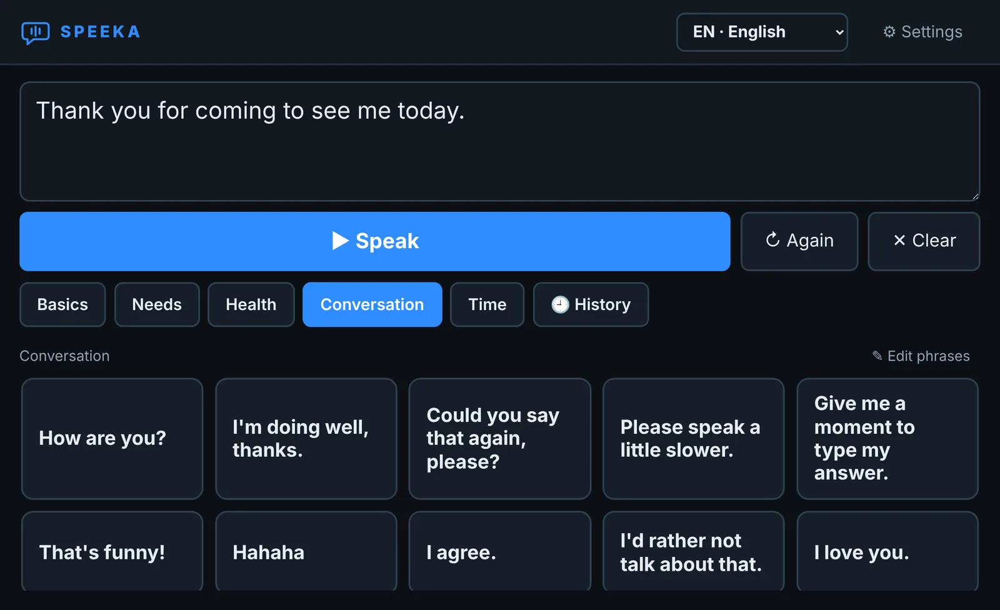

# Speeka

**Speeka speaks for you.** Type a sentence or tap a phrase and Speeka says it out loud in a
natural voice. Everything runs offline on your device: no cloud, no account, no data leaving it.

Speeka is an AAC (augmentative and alternative communication) app for anyone who can write but
can't speak, for good or just for a while: after throat surgery, after a stroke, with ALS/MND,
with a lost voice, or in a hospital abroad where nobody understands you.

The project used to be called Vox; the code still uses that name internally (`Vox.Mobile`,
the `Vox` namespace, the `%APPDATA%\Vox` data folder). The program file is `Speeka.exe`.

**[Get it from Microsoft Store](https://apps.microsoft.com/detail/9P6NKBZXT3VX)** · [portable ZIP](https://github.com/martin-sedrmajer/speeka/releases/latest) · [website with a voice sample](https://martin-sedrmajer.github.io/speeka/)



## Features

- **Natural offline voice in ten languages:** Czech, English, Slovak, Polish, German, Spanish,
  French, Italian, Ukrainian and Russian. Speeka ships with
  [Supertonic 3](https://huggingface.co/Supertone/supertonic-3) running locally through
  [sherpa-onnx](https://github.com/k2-fsa/sherpa-onnx). The same voice speaks every language.
- **Language picker** in the top bar, recently used languages first. It changes the phrase
  buttons, group names and the voice. All default phrases are translated; phrases sit in the
  same place in every language.
- **Translation under each phrase** (optional) into your own language, so you know what you
  are saying in a foreign language.
- **App in Czech or English.** The interface language is a separate setting, so switching the
  speech language never changes the controls.
- **Phrase board.** Ready-made phrases in groups (basics, needs, health, conversation, time),
  with your own phrases and groups. Urgent phrases get large red buttons. Editing starts with a
  long press, so it never opens by accident.
- **History** of what you said. Tapping an item repeats it.
- **Long-press** (or right-click) a phrase to put it into the text box and finish the sentence.
- **Emoticons** such as `:D` and `xD` are spoken as laughter; other emoticons and emoji are skipped.
- **Sound for real rooms.** Volume up to 200 % with a limiter, level matching, a clarity boost for
  listeners who are hard of hearing, and optional robot or radio effects.
- **Pronunciation dictionary** for each language, for words the voice gets wrong.
- **Voice quality setting:** fewer computation steps for faster speech on slower devices.
- **Caregiver lock.** Settings and phrase editing can be locked behind a simple arithmetic problem.
- **Accessible layout.** Three font sizes, dark and high-contrast light themes, five accent
  colours, and a mirrored layout (Flip UI).
- **Android extras:** haptic feedback, and the volume-down button can speak the text (optional).
- **Bring your own voices (Windows).** Other sherpa-onnx voices (Kokoro, Piper) and installed
  Windows voices work too.

## Requirements

- Windows 10 or 11, 64-bit, with Microsoft Edge WebView2 Runtime (included in current Windows)
- Android 7.0 or later (in testing)

The portable Windows build includes .NET and the voice, so nothing else needs to be installed.

## Building

Windows development build (needs the .NET 8 SDK):

```
dotnet publish Vox\Vox.csproj -c Release -r win-x64 --self-contained false -o publish\Vox
```

Put the Supertonic model folder
([sherpa-onnx-supertonic-3-tts-int8-2026-05-11](https://github.com/k2-fsa/sherpa-onnx/releases/download/tts-models/sherpa-onnx-supertonic-3-tts-int8-2026-05-11.tar.bz2))
into `%APPDATA%\Vox\voices`.

Portable release build (self-contained, with the voice bundled and zipped):

```
powershell -ExecutionPolicy Bypass -File build-portable.ps1
```

The result is `dist\Speeka-<version>-win-x64.zip`. With `-Msix` the script also builds a
Microsoft Store package (`dist\Speeka-<version>-x64.msix`), using the identity in
`Package\StoreIdentity.json` and `makeappx.exe` from the Windows SDK.

Android (.NET MAUI, needs the .NET 10 SDK with the `maui-android` workload and the Android SDK):

```
powershell -ExecutionPolicy Bypass -File build-android.ps1           # debug build, installs to a running emulator or phone
powershell -ExecutionPolicy Bypass -File build-android.ps1 -Release  # signed .aab for Google Play
```

The Windows and Android apps share the page (`Vox\wwwroot`), the bridge (`Vox\Bridge.cs`),
settings, phrases and voice code.

## Status and roadmap

Early version, built and tested by one developer. Feedback from AAC users, speech therapists,
caregivers and native speakers (for the phrase translations) is very welcome.

Planned:

- Android release on Google Play
- Testing with real users and speech therapists
- Faster speech on older phones (pre-computed common phrases)
- Personal voice from the user's own recordings, for people who are about to lose their voice

## License

Speeka is licensed under the [GNU General Public License v3.0](LICENSE) or later, with an
additional permission for the Microsoft Edge WebView2 SDK and Runtime
(see [LICENSE-EXCEPTION.txt](LICENSE-EXCEPTION.txt)).

Third-party components keep their own licenses, see
[THIRD-PARTY-NOTICES.txt](THIRD-PARTY-NOTICES.txt). The bundled Supertonic 3 model is
licensed under OpenRAIL-M.

---

## Česky

**Speeka mluví za vás.** Napíšete větu nebo klepnete na frázi a Speeka ji řekne přirozeným
hlasem v deseti jazycích. Běží celá offline, bez cloudu a bez účtu. Je určená každému, kdo umí
psát, ale nemůže mluvit, natrvalo nebo jen na čas. Dříve se jmenovala Vox. Podrobný technický
popis je v souboru README.txt.
